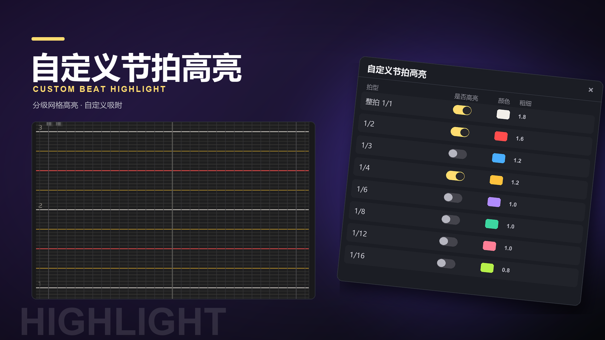

# 自定义节拍高亮（Custom Beat Highlight）



RPEN（Re:PhiEdit Next）模组 · API 1 · 版本 **1.2.1**

模组作用：给制谱网格加上**分级高亮**与**自定义吸附**：不改动原生网格与谱面数据，把各节拍细分用不同颜色标出来，并让音符/事件吸附到选定的节拍型或原生细网格。

完整功能说明见 [**beat-grid-guide/README.zh-CN.md**](beat-grid-guide/README.zh-CN.md)。

作者：一只仰望星空的小狼，并使用Deepseek进行编程实现（AI简直太好用了你知道吗（？）

## 下载

直接下载最新打包文件（从 `dist/` 读取）：

- [**自定义节拍高亮-Custom-Beat-Highlight-v1.2.1.rpenmod**（推荐）](https://github.com/AWolfLUTS/RPEN--rpen-custom-beat-highlight/raw/main/dist/%E8%87%AA%E5%AE%9A%E4%B9%89%E8%8A%82%E6%8B%8D%E9%AB%98%E4%BA%AE-Custom-Beat-Highlight-v1.2.1.rpenmod)
- [自定义节拍高亮-Custom-Beat-Highlight-v1.2.1.zip](https://github.com/AWolfLUTS/RPEN--rpen-custom-beat-highlight/raw/main/dist/%E8%87%AA%E5%AE%9A%E4%B9%89%E8%8A%82%E6%8B%8D%E9%AB%98%E4%BA%AE-Custom-Beat-Highlight-v1.2.1.zip)

或到 [**Releases**](https://github.com/AWolfLUTS/RPEN--rpen-custom-beat-highlight/releases/latest) 下载带版本号的附件。

## 目录结构

```
RPEN模组项目/
├─ beat-grid-guide/        # 模组源码（入口 main.mjs，清单 mod.json）
│   ├─ mod.json
│   ├─ main.mjs
│   ├─ config.mjs
│   ├─ grid-model.mjs
│   ├─ renderer.mjs
│   ├─ snapping.mjs
│   ├─ panel.mjs
│   ├─ style.css
│   ├─ icons/icon.svg
│   └─ README.zh-CN.md
├─ dist/                   # 模组本体
│   ├─ 自定义节拍高亮-Custom-Beat-Highlight-v1.2.1.rpenmod
│   └─ 自定义节拍高亮-Custom-Beat-Highlight-v1.2.1.zip
├─ scripts/build.py        # 自动打包脚本（读取 mod.json 自动命名）
├─ docs/protocol/          # RPEN 官方模组协议文档（模组开发参考资料）
├─ README.md               # 本文件
├─ CHANGELOG.md            # 更新日志
├─ LICENSE                 # 许可证
└─ .gitignore
```

## 安装 / 使用

1. 编辑器「模组 → 导入模组包」，在下载的项目目录中找到 `dist/beat-grid-guide.rpenmod`（或 `.zip`），选择并导入。
2. 勾选风险确认后需要**手动启用**。
3. 工具条「吸附」右侧会出现「网格」按钮，点击打开设置面板。

默认快捷键：`M` 开关高亮、`N` 切换吸附模式（可在模组管理器里改键）。

## 从源码打包

运行 `python scripts/build.py` 即可，会在 `dist/` 生成 `中文-英文-v版本号.rpenmod` 与同名 `.zip`（根目录包含 `mod.json`）。

也可以手动把 `beat-grid-guide/` 目录内容打包为 zip（**根目录必须直接包含 `mod.json`**），扩展名可用 `.rpenmod` 或 `.zip`；编辑器「模组 → 导入」即可。

## 更新日志

见 [CHANGELOG.md](CHANGELOG.md)。

## 许可证

本项目采用 **PolyForm Noncommercial 1.0.0**（非商业许可）：

* 允许：任何**非商业**用途的复制、修改、分发（个人、学习、研究、教学、公益机构等）；
* 禁止：任何**商业用途**（售卖、付费分发、商业整合等）；
* 不要求署名。

完整条款见 [LICENSE](LICENSE)。

> 说明：`docs/protocol/` 为 RPEN / Re:PhiEdit Next 的官方模组协议文档，版权归原作者，仅作开发参考。

